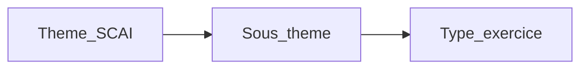

# Exercices Grammaire (conjugaison + PDF)

## Décisions figées

- **UI = option A** : Thème SCAI → **Sous-thème** (3ᵉ menu, modèle Lettre Soutien) → **Type d’exercice** (8 kinds).
- **8 types** :
  1. Choisissez la bonne conjugaison — phrase + 3 options, `A.` □
  2. Conjuguez le verbe — verbe entre parenthèses, ligne de réponse
  3. Choisissez le verbe correct — phrase + 3 formes, QCM
  4. Mettre au pluriel
  5. Mettre au singulier
  6. Mettre à la forme négative
  7. Mettre à la forme affirmative
  8. Écrire une phrase (verbe donné + mot donné)
- **Livraison d’un coup** : soutien-scolaire + 2 PDF dans le même chantier.
- Théorie FALC inchangée (`*-theorie`) ; exercices = types séparés.
- PDF : uniquement les exercices (pas théorie, pas « lire / observer »).

## Architecture UI

- Thèmes conjugaison : `gram-present`, `gram-passe`, `gram-avenir`.
- Sous-thèmes présent : Être, Avoir, -er, -er particuliers, -ir, -re/-oir, modaux, pronominaux.
- Passé / avenir : sous-thèmes = notions catalogue existantes.
- Autres thèmes SCAI : exercices PDF mappés sur les fiches théorie du thème.
- SelectBox Sous-thème dans `DomainThemeTypeFields` (comme Lettre Soutien).
- Type = Théorie liée + 8 kinds (ceux avec banque non vide).
- Questions visibles pour les exercices ; colonnes = 1.

Ids : `gram-{sub}-{kind}` avec `topic` = thème SCAI.

## Données

Nouveau `src/grammaire/exercises/` :

- `kinds.ts`, `subthemes.ts`, `types.ts`
- `bank/*.json` — phrases par typeId
- `generate.ts` — `createRng` + shuffle QCM
- scripts import soutien + PDF

Layouts : `gram-qcm`, `gram-fill`, `gram-write` dans ItemView.

## Étape 1 — soutien-scolaire

Sources : `conj-exercise-builders.ts`, `conj-lesson-profiles.ts`, `grammaire-g*.ts`, `generated-grammar-exercises.ts`.

Import → pools figés JSON (pas de dépendance runtime). Mapping builders → 8 kinds (conjugaison, pluriel, négation, write, etc.).

## Étape 2 — PDF A1 / A2

- Extraire texte (script Node pdf one-shot).
- Garder seulement items d’exercice.
- Ranger dans thème/sous-thème SCAI ; fusionner / dédupliquer avec banque soutien.
- OCR si PDF scanné.

## Fichiers touchés

`src/grammaire/*`, catalog, generate, ItemView, DomainThemeTypeFields, generator-block-context, App.css, README.

## Hors scope

Traductions FALC, refonte théorie, domaine Conjugaison séparé.

## Livraison

Commit + push `origin/main`.
